# SMAJ PI HUB

**The Economic Utility Layer for the Pi Ecosystem**

SMAJ PI HUB brings commerce, work, media, and a growing set of service experiences into one mobile-focused application. Its foundation is shared Pi identity, application accounts, and Pi payment workflows. **SMAJ Store and SMAJ Jobs are the initial economic focus**, with additional services developed in stages.

This repository contains the React web application, its Capacitor Android shell, an Express/MongoDB backend, a separate Expo/React Native client, shared packages, and a knowledge-based Telegram bot. It has developed beyond its original Pi Platform example-app foundation.

**[Open SMAJ PI HUB](https://smajpihub.com)** · [SMAJ Ecosystem](https://smaj.org) · [White Paper](https://smajpihub.com/white-paper) · [Android downloads](https://smajpihub.com/download) · [SMAJ AI](https://smaj-verified-delegation.onrender.com)

> **Implementation boundary:** “Implemented” below means the repository contains the corresponding interface and backend logic. It does not certify a configured production integration, an independently verified business, successful fulfillment, or a completed Mainnet payment. Several services contain explicitly identified prototypes or fallback data.

## Contents

- [Mission and current scope](#mission-and-current-scope)
- [Services and implementation status](#services-and-implementation-status)
- [Shared platform features](#shared-platform-features)
- [Mobile screenshots and user guides](#mobile-screenshots-and-user-guides)
- [Technology and architecture](#technology-and-architecture)
- [Install and run locally](#install-and-run-locally)
- [Environment variables](#environment-variables)
- [Pi authentication and payments](#pi-authentication-and-payments)
- [AI architecture](#ai-architecture)
- [Backend APIs and database](#backend-apis-and-database)
- [Roles and permissions](#roles-and-permissions)
- [Testing](#testing)
- [Deployment and Android builds](#deployment-and-android-builds)
- [Security and operational limits](#security-and-operational-limits)
- [Troubleshooting](#troubleshooting)
- [Contributing, official references, and license](#contributing-official-references-and-license)

Source review: **7 November 2026**, based on [`1e34d49`](https://github.com/SMAJORG/smajpihub/commit/1e34d49). This documentation describes source capabilities, not a production acceptance certificate.

## Mission and current scope

The [White Paper, version 2.0](By_smaj_pi_hub_white_paper_v2.md), describes a phased platform connecting people and businesses to useful economic activity through Pi. The practical starting point is buying and selling goods and finding or offering work. The wider service portfolio is a modular roadmap, not a promise that every service launches together.

Pi authentication establishes an application identity. It does not guarantee seller reliability, legal business verification, delivery, employment, medical availability, or protection from fraud. A potential SMAJ token is **deferred and outside the current launch plan**. The application is a marketplace and service platform, not a bank or an independently implemented Pi wallet.

## Services and implementation status

The directory contains fifteen service concepts. Launch labels are administrator-managed through site content; source defaults mark **Store, Jobs, and Stream** live, with other services in progress or coming soon. A visible card or a `live` label is not evidence of complete operational readiness. The separate Expo directory can have different launch labels.

**Implemented:** substantial persisted application workflows exist. **Partial:** backend or UI exists, with incomplete integrations or operational steps. **Experimental:** local/sample workflows demonstrate an interface. **Planned:** no complete executable service is provided.

| Service | Source-backed functionality | Status and limits |
| --- | --- | --- |
| **Store** | Catalog search/filtering, product detail, seller profiles and tools, product submission/moderation, favorites, messaging, order creation and fulfillment, delivery confirmation, reviews, disputes/refund requests, Pi checkout and recovery, settlement records. | **Implemented core.** Requires configured storage, identity, payments, and transaction-capable MongoDB for financial operations. Delivery and seller payouts are not automatic fulfillment guarantees. |
| **Jobs** | Listings and company pages, employer enrollment and claims, candidate profiles and preferences, protected CV handling, saved jobs, applications/withdrawal, employer pipeline, notes/interviews/offers, company/candidate moderation, billing plans/intents, earnings/payment records and disputes. | **Implemented core; partial external settlement.** Employer-backed records and verified company status are separate checks. Development seed listings are not real vacancies; a payment record is not proof of a salary transfer. |
| **Stream** | TMDB discovery, movies/series detail, creator uploads and channels, posts, public creator metadata, Cloudflare video/live inputs, configured YouTube live sources, Internet Archive import, playback/progress/history, favorites, subscriptions, reviews, download eligibility, analytics and moderation/deletion. | **Implemented, provider-dependent.** Metadata does not grant playback or download rights. Uploads, live video, Pi subscriptions, and permitted downloads require their respective configuration and content permissions. |
| **Education** | University/program directories and claims, teaching applications, tutors/lesson requests, course creation and review, video lessons, enrollment, learning progress, quizzes, certificates/public verification, institution applications and administrative/learning portals. | **Partial / rollout-gated.** Significant backend implementation exists despite coming-soon labels. Partner status, evidence, course publishing, payment flags, and provider availability control access. A directory entry is not a university partnership or accreditation. |
| **Sports** | Matches, teams, competitions, standings, news, saved preferences and onboarding; provider fetching and caching. | **Partial.** TheSportsDB/NewsAPI configuration governs external data. Sample/fallback content must not be represented as a verified live score feed. |
| **Food** | Restaurant/menu discovery, cart, deals, and order interfaces. | **Experimental.** The client calls food endpoints that are not mounted by this backend and falls back to bundled restaurants/menus; no complete restaurant fulfillment integration. |
| **Health / CareRoute** | Hospital discovery and matching, request/tracking interfaces, hospital intake/capacity/doctor controls, legacy appointment/provider screens. | **Experimental / partial.** CareRoute includes demo hospitals and in-memory fallback; its optional collection bindings are not initialized by the main database bootstrap. Legacy health APIs also fall back to sample data. Not a verified emergency dispatch or clinical service. |
| **Transport** | Ride/flight booking records, driver/vehicle/location and trip interfaces, notifications, receipts, Google Places address lookup, and flight payment handlers. | **Partial / experimental inventory.** No complete airline ticketing or commercial dispatch integration. Flight payment handlers reject bookings without a provider reference; local booking/status records do not establish a real reservation. |
| **Agro** | Product/supplier discovery, saved items, quote/request/order forms. | **Experimental.** Bundled content and browser-local records; no mounted Agro commerce backend. |
| **Energy** | Products/providers, utility, quote, booking, order, and payment-history interfaces. | **Experimental.** Browser-local records and example data; no utility-provider settlement integration. |
| **Charity** | Campaign/organization discovery, saved causes, donation/fundraising screens and receipt interfaces. | **Experimental.** Local/sample workflows; no verified charitable disbursement pipeline. |
| **Housing** | Properties/agents, saved and comparison views, viewing/booking and listing interfaces. | **Experimental.** Client fallback listings and locally handled flows; no mounted Housing API or verified property fulfillment. |
| **Events** | Event discovery, saved items, organizer/create flows, ticket/checkout/QR interfaces. | **Experimental.** Local/sample ticket records; no complete issuer, venue, or payment integration. |
| **Swap** | Token/pool/liquidity screens and simulated swap history. | **Experimental.** The interface explicitly records simulated transactions in local storage; no on-chain exchange, liquidity pool, or trading engine. |
| **Token** | Informational/rewards surfaces and a disabled coming-soon action. | **Planned / deferred.** No token issuance, redemption, staking, or on-chain reward contract is implemented. |

Primary evidence: [web service catalog](frontend/src/content/serviceCatalog.ts), [router](frontend/src/Router.tsx), [backend handlers](backend/src/handlers), and [Expo service directory](mobile/src/lib/services.ts). Food, legacy Health, and Housing fallback behavior is visible in [frontend API clients](frontend/src/lib).

## Shared platform features

- **Accounts and access:** Pi sign-in, buyer/seller profiles, seller activation, verification requests and badges, configurable administrator usernames, session restoration, device-session listing/revocation, sign-out, and account settings. Verification badges are application-managed states, not a replacement for independent diligence.
- **Commerce and financial records:** seller dashboards, inventory reservations/expiry, payment recovery, order timelines, disputes and refund requests, reconciliation, and verified settlement-record handling. The wallet screen aggregates recorded activity by service/network; its displayed zero balance is explicitly a **placeholder, not the user's actual wallet balance**.
- **Messaging:** participant-scoped conversations, product and Jobs context, text/image/voice media, gallery and recorder interfaces, typing/presence, incremental synchronization, archive/delete, and client message idempotency. This implementation uses HTTP synchronization/polling, not an assumed WebSocket server.
- **Notifications:** persisted in-app notifications, read/delete controls, browser Web Push/VAPID, and native Firebase push registration/sending when configured.
- **Homepage content boundary:** the dashboard can display bundled fallback seller cards and beta activity when real data is absent. Treat their ratings/counts as examples, not usage or trust evidence. Administrator-managed sections can likewise contain editorial cards.
- **Discovery and administration:** search, service launch warnings, guided tutorials, help/support and onboarding forms, ambassador applications/review, administrative analytics, users/products/orders/reports, hero-banner management, and editable homepage/service content.
- **Localization:** ten bundled interface catalogs—English, French, Arabic, Hausa, Spanish, Portuguese, Simplified Chinese, Swahili, Hindi, and Turkish—with Arabic RTL support. Optional, explicit dynamic-content translation uses the backend; unsupported/unavailable pairs retain the original content. Interface localization does not require translation servers. See [localization architecture](docs/LOCALIZATION.md).
- **Mobile capabilities:** the Capacitor implementation includes device/browser handoff, camera/file selection, geolocation, sharing/clipboard, network state, local notifications, native push, secure session storage, biometric/device-credential app lock, consent-gated Android test-ad placements, and update discovery. Hardware services, permissions, and release/update behavior need device testing.
- **Engagement and rewards:** an account-aware Engagement Tasks page and coming-soon rewards surfaces exist. Dynamic task feeds, rewards APIs, token redemption and real ad-earned value are not implemented; Android ad code uses test placement IDs.
- **Offline behavior:** selected API reads have user-namespaced IndexedDB caching and retry handling. Offline mutations are blocked; this is not offline checkout, guaranteed messaging delivery, or a synchronized financial ledger.

## Mobile screenshots and user guides

All images below are **portrait mobile captures**, taken at a **390 × 844 CSS-pixel viewport, 2× scale**, from the actual interfaces; the dashboard uses a native viewport crop for readability. They are mobile-browser captures, **not APK/emulator or physical-device certification**. No desktop/laptop screenshots, fabricated transactions, or edited interface states are used.

Public captures come from `smajpihub.com`. Protected-screen captures marked **local development** use the existing `/user/dev-signin` endpoint with isolated in-memory storage and payments disabled. The resulting `localdev` account, its badges, empty catalogs, and zero amounts are development fixtures—not verified Pi identity, real balances, sales, or transfers. The dashboard also contains bundled fallback seller/activity cards; their names, ratings, and listing counts are UI examples, not verified business statistics.

### 1. Explore the homepage, services, and Pi sign-in

<a href="docs/screenshots/01-mobile-home.png">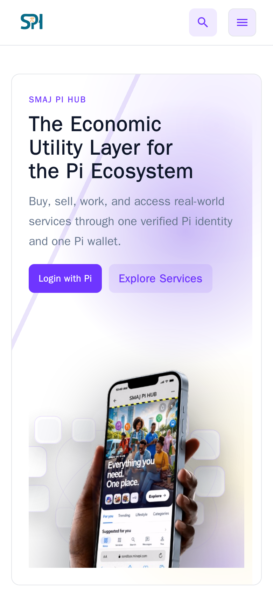</a>
<a href="docs/screenshots/02-mobile-services.png">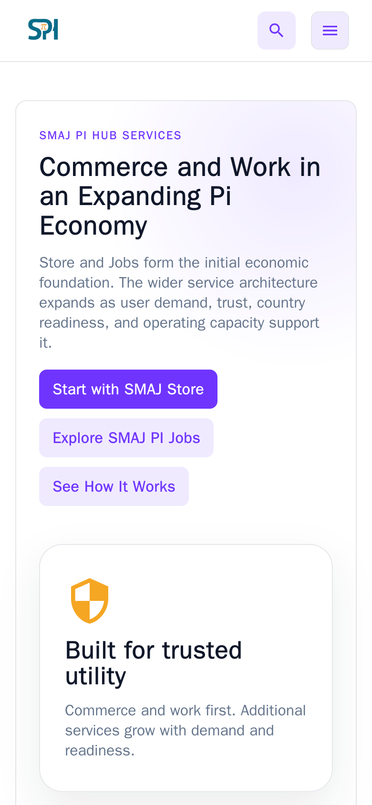</a>
<a href="docs/screenshots/03-mobile-pi-login.png">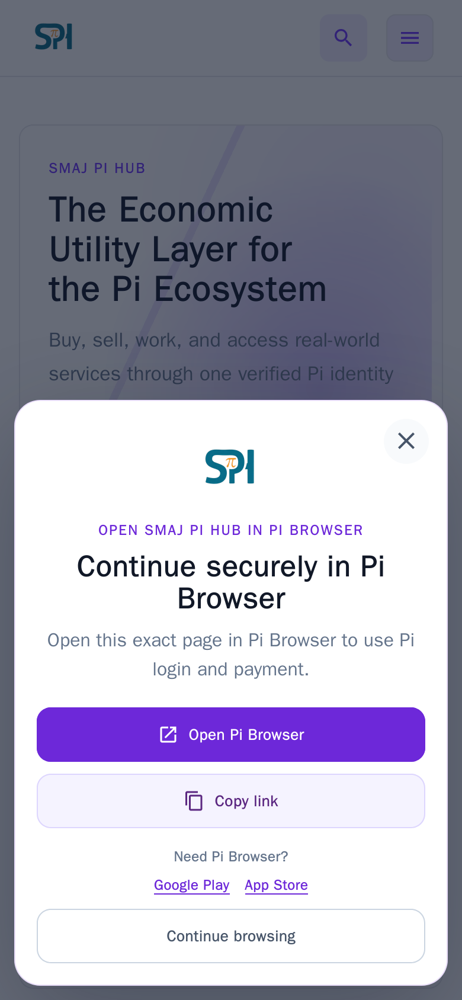</a>

1. Open [SMAJ PI HUB](https://smajpihub.com) on your phone and choose your cookie preferences.
2. Open **Services** to inspect availability. In-progress services display a warning rather than a guarantee of full functionality.
3. Choose **Login with Pi**. Use Pi Browser for the web SDK flow; outside Pi Browser, use the application's handoff. Approve only the identity permissions shown by Pi.
4. Return to the app after successful authentication. Native Android uses its configured OAuth callback flow instead.

### 2. Use the dashboard and marketplace

<a href="docs/screenshots/20-mobile-service-launcher-local.png">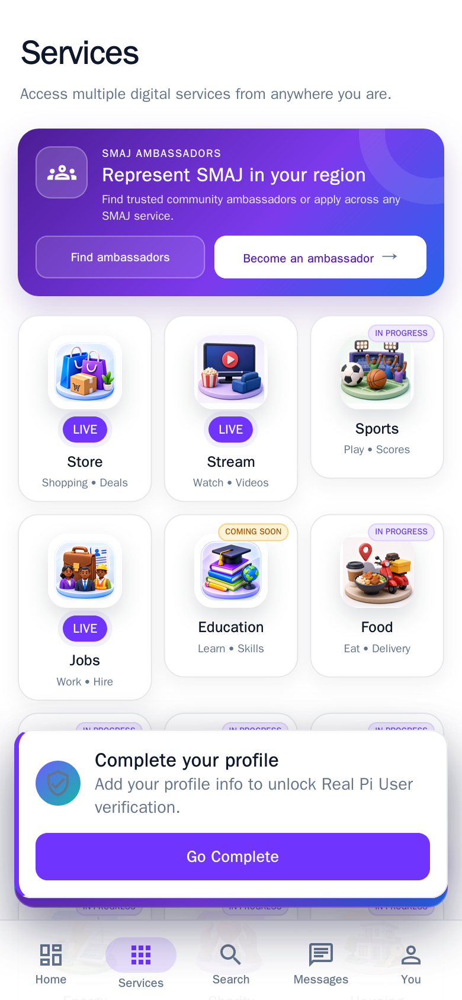</a>
<a href="docs/screenshots/11-mobile-dashboard-local.png">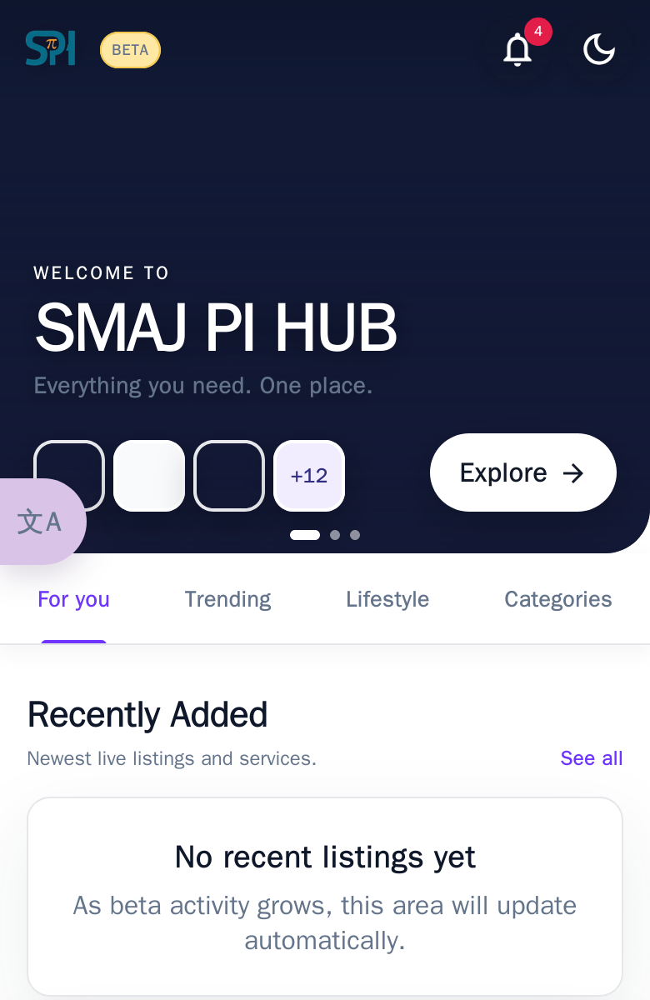</a>
<a href="docs/screenshots/12-mobile-marketplace-local.png">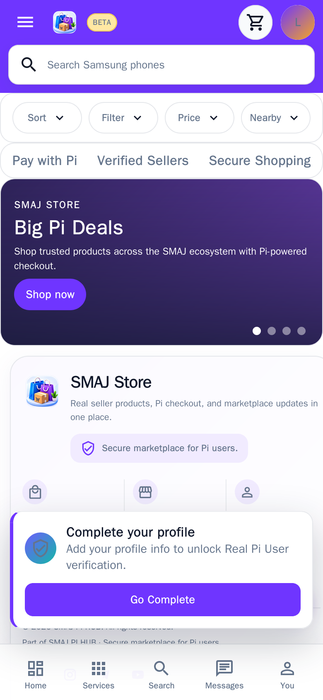</a>
<a href="docs/screenshots/14-mobile-seller-local.png">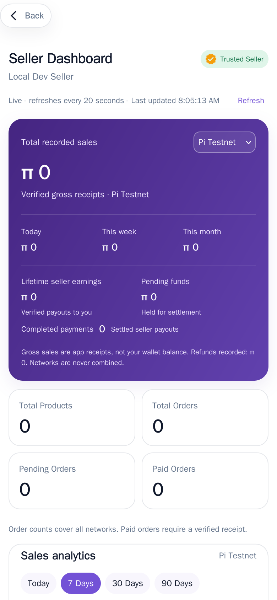</a>

**Local development captures; no production account or transactions.**

1. After signing in, open the dashboard and select **Store**.
2. Search/filter published listings, open a product, inspect seller information, and contact the seller when appropriate.
3. A seller can activate seller tools, submit products, and review their availability/moderation state. Submission does not automatically imply publication.
4. Create an order only when ready. Continue through the actual Pi checkout; an order created with payment pending is not paid.

### 3. Inspect payments and wallet activity

<a href="docs/screenshots/19-mobile-payment-method-local.png">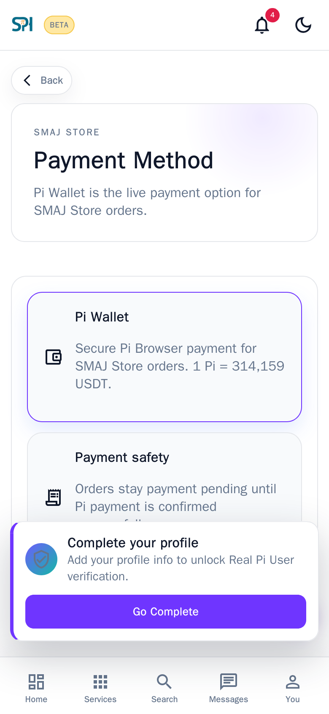</a>
<a href="docs/screenshots/13-mobile-wallet-local.png">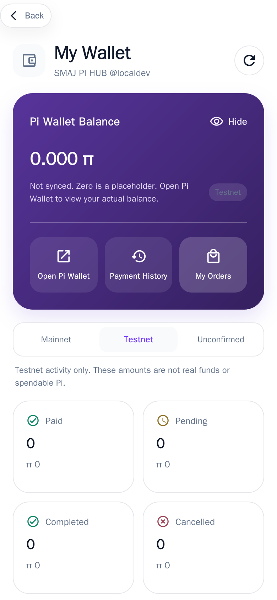</a>

**Local development capture; payments disabled.** The wallet's “Not synced” explanation is part of the actual UI. No successful payment was simulated for this documentation.

1. Open **Wallet** to inspect recorded activity, network tabs, and service/payment filters.
2. Keep Testnet, Mainnet, and unconfirmed-network records distinct.
3. Use **Open Pi Wallet** for the authoritative wallet application and actual balance.
4. If checkout is interrupted, resume the existing order/payment. Do not create a second transfer merely because a callback or page refresh failed.

### 4. Messages, account controls, and AI

<a href="docs/screenshots/15-mobile-messages-local.png">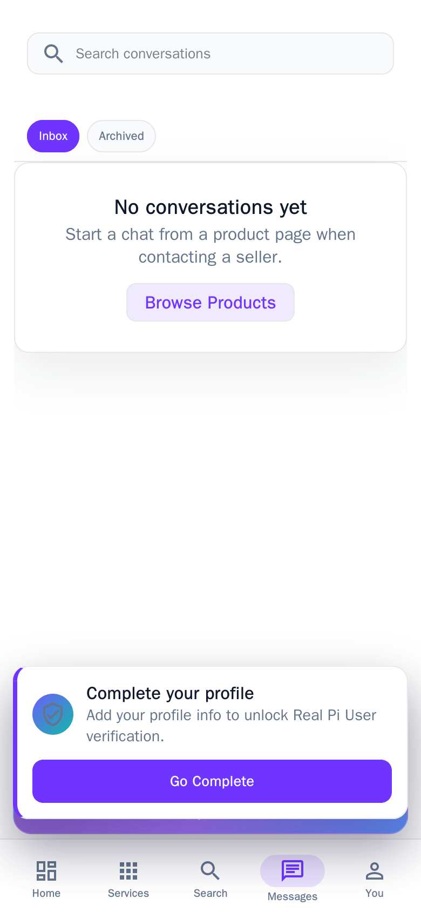</a>
<a href="docs/screenshots/16-mobile-settings-local.png">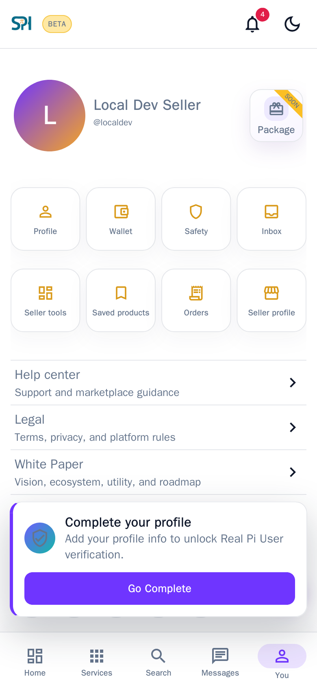</a>
<a href="docs/screenshots/17-mobile-ai-local.png"></a>

**Local development captures.** The local AI bridge is unconfigured; this screenshot documents the actual interface and its availability state, not a successful AI request.

<details>
<summary>Standalone companion AI on mobile</summary>

<a href="docs/screenshots/18-mobile-standalone-ai.png">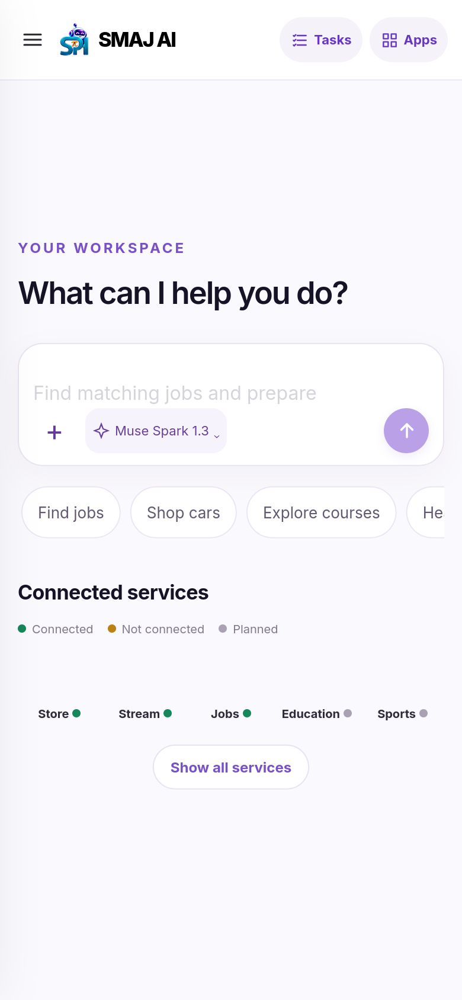</a>

This is a genuine capture of the **separate public companion application**, not the embedded Hub workspace. Its visible model selector and service launcher do not demonstrate that this local Hub's bridge is configured. No generated answer or delegated action is claimed by this capture.

</details>

1. Open **Messages** from an existing seller/product or permitted Jobs conversation. Review the recipient and context before sending text or media.
2. Use account settings for preferences and device sessions. Android app lock and native notification options depend on the platform.
3. Open **SMAJ AI** after Hub sign-in. A deployed bridge and companion AI service are required for responses, saved tasks, and supported approvals.
4. Review any exact proposed action before approval. A plan, draft, or unavailable-delivery status must not be interpreted as a completed external action.

## Technology and architecture

| Layer | Repository implementation |
| --- | --- |
| Web/mobile UI | React 19, TypeScript, Vite 7, React Router 7, MUI, Tailwind CSS, styled-components; Axios; i18next/react-i18next; Leaflet, Recharts, HLS.js and tus where used. |
| API | Express 4, TypeScript, MongoDB Node driver 6, express-session/connect-mongo, Axios, Firebase Admin and web-push. |
| Primary database | MongoDB; version 7 is used in the repository's Compose setup. Financial transactions require a replica set/compatible transactional deployment. |
| Android web client | Capacitor 8 and Android Gradle project in `frontend/android/`; Java 21 in release CI; Android API levels are defined in [variables.gradle](frontend/android/variables.gradle). |
| Separate native client | Expo SDK 57, React Native 0.86, Expo Router and SecureStore in `mobile/`. |
| Shared packages | `@smaj/shared-types`, `@smaj/design-tokens`, `@smaj/api-client`. |
| Bot | Telegraf, Express 5, local curated knowledge; Node 20+ declared by the bot. |
| Tooling | Node 24 in current GitHub Actions, npm lockfiles, TypeScript checks, Node test suites and Playwright. The backend Dockerfile currently uses Node 20. |

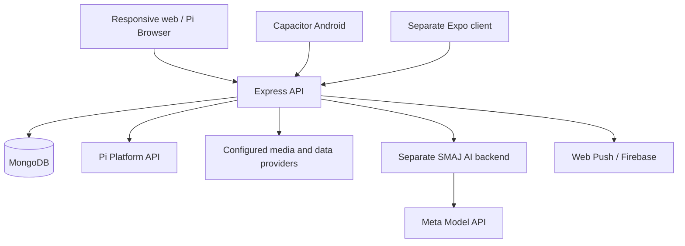

The backend is modular Express routing over shared application collections, not fifteen independently deployed microservices. Pi's SDK/wallet handles user authorization and blockchain interaction; the Hub verifies supported payment flows and persists its own records. The Telegram knowledge bot is a separate process, not a Meta model server.

### Repository map

```text
frontend/              React/Vite app, public assets, Capacitor Android, UI tests
backend/               Express handlers, services, types, MongoDB initialization, tests
mobile/                Separate Expo/React Native client and OAuth tests
packages/              Shared API client, types and design tokens
sph-bot/               Telegram knowledge bot
.github/workflows/     Pages, Android, localization and layout automation
docs/                  Architecture, audits and operational notes
doc/                   Earlier development/deployment and integration guides
solohost/              Alternative self-hosted deployment packaging
reverse-proxy/         Legacy reverse-proxy/container support
```

The root npm workspaces cover `mobile/` and `packages/*`. **Frontend and backend have their own install/build commands and lockfiles.**

### Two Android implementations

- **Capacitor (`frontend/android/`):** packages the existing web UI, with native plugins and Android-specific authentication, storage, ads, notifications, and update code. CI builds signed APK/AAB artifacts. A generated artifact or prerelease is not evidence of Google Play approval or complete device acceptance testing.
- **Expo (`mobile/`):** a separate native interface with Home, Services, Search, Messages and You tabs; Store browsing/detail/order creation and order history; messages and notifications; shared API access and OAuth sign-in. Other service pages link to the current web experience. The native order screen creates pending orders and displays history; it does **not** implement the web client's complete Pi checkout flow. See [native setup and limitations](mobile/README.md).

Both declare `com.smajpihub.mobile`; they are alternative client implementations, not two independently installable product IDs. Both require their own correctly configured build and device validation.

## Install and run locally

### Prerequisites

Use **Node.js 24 and npm** to match current CI. Use MongoDB/Atlas with transaction support for persistent financial workflows. Android builds additionally require Java 21, Android SDK tooling, and the appropriate signing material. Real Pi sign-in/payment testing requires your own Pi Developer Portal application and supported browser/device.

```sh
git clone https://github.com/SMAJORG/smajpihub.git
cd smajpihub
npm ci --prefix backend
npm ci --prefix frontend
cp backend/.env.example backend/.env
```

Do not commit `.env` files or copy the root template's historical sample credentials into a deployment. Generate a unique session secret, for example with `node -e "console.log(require('node:crypto').randomBytes(48).toString('hex'))"`.

For a disposable UI/API development environment, edit **`backend/.env`**:

```dotenv
NODE_ENV=development
PORT=8000
SESSION_SECRET=replace_with_your_generated_random_secret
FRONTEND_URL=http://localhost:3314
USE_MEMORY_DB=true
DEV_AUTH=false
PI_PAYMENTS_ENABLED=false
PI_NETWORK=Pi Testnet
```

Create **`frontend/.env.development`**:

```dotenv
PORT=3314
VITE_API_BASE_URL=http://localhost:8000
VITE_BACKEND_URL=http://localhost:8000
VITE_SANDBOX_SDK=true
```

Start each component in its own terminal so the backend reads its local `.env`:

```sh
# Terminal 1, from the repository root
cd backend
npm start
```

```sh
# Terminal 2, from the repository root
cd frontend
npm run dev
```

Open `http://localhost:3314`; backend health is at `http://localhost:8000/health`. Memory data resets when the API restarts and does not establish production persistence or transactional guarantees.

For UI-only development, the existing `POST /user/dev-signin` endpoint can be enabled with **`DEV_AUTH=true` in a non-production backend**. It creates the fixed development account, not a Pi-verified real user. Keep payments disabled and never enable this mode in a live deployment. It is unavailable in production.

For persistent development, use `USE_MEMORY_DB=false` with your own `MONGODB_URI`, or the legacy `MONGO_HOST`/database/user/password settings. Use a **MongoDB replica set**, including for local payment-integrity tests; a standalone MongoDB process is insufficient for operations using `withTransaction`.

## Environment variables

All examples are placeholders. `VITE_*` and `EXPO_PUBLIC_*` values are compiled into clients and **must contain only public configuration**. Secrets belong to backend or CI environments.

### Backend essentials

| Variable | Purpose |
| --- | --- |
| `NODE_ENV`, `PORT`, `FRONTEND_URL` | Runtime mode, listener port, and exact comma-separated browser origins. Render environment detection also enables production checks. |
| `SESSION_SECRET` | Unique strong session-signing secret; required in production. |
| `MONGODB_URI` | Preferred full MongoDB connection URI; keep credentials server-side. |
| `MONGO_HOST`, `MONGODB_DATABASE_NAME`, `MONGODB_USERNAME`, `MONGODB_PASSWORD` | Alternative connection settings when a full URI is absent. |
| `USE_MEMORY_DB`, `DEV_AUTH` | Development-only switches; memory mode is rejected by production validation and dev sign-in is unavailable there. |
| `ADMIN_PI_USERNAMES` | Deliberate administrator provisioning by normalized Pi username; restrict and review carefully. |
| `PI_PAYMENTS_ENABLED`, `PI_API_KEY`, `PI_NETWORK` | Global Pi API-key payment gate, server credential, and expected network (`Pi Testnet` or `Pi Network`). Set the gate explicitly; it defaults enabled outside SoloHost. |
| `PLATFORM_API_URL` | Defaults to `https://api.minepi.com`; changing it does not replace correct network/app configuration. |
| `MARKETPLACE_AUTO_APPROVE_PRODUCTS` | Product moderation shortcut; normally false. |
| `SESSION_DEBUG` | Optional session diagnostics; avoid unnecessary production logging. |

### Optional integrations

| Variables | Enable |
| --- | --- |
| `CLOUDINARY_CLOUD_NAME`, `CLOUDINARY_UPLOAD_PRESET`, `CLOUDINARY_FOLDER` | Image/media storage. Non-SoloHost production startup requires the cloud name and preset. |
| `CLOUDINARY_API_KEY`, `CLOUDINARY_API_SECRET` | Protected CV storage/signing; without them CV operations fail closed rather than using public document storage. |
| `TMDB_ACCESS_TOKEN` | Server-side film/series metadata. |
| `CLOUDFLARE_STREAM_ACCOUNT_ID` (or `CLOUDFLARE_ACCOUNT_ID`), `CLOUDFLARE_STREAM_API_TOKEN` | Creator/video/live upload and playback integration. |
| `YOUTUBE_API_KEY`, `YOUTUBE_LIVE_CHANNEL_IDS`, `YOUTUBE_LIVE_REFRESH_MINUTES` | Configured official live-channel discovery/refresh. |
| `SPORTS_PROVIDER`, `SPORTS_API_KEY`, `SPORTS_LEAGUE_IDS`, `SPORTS_CACHE_SECONDS`, `NEWS_API_KEY` | Sports data and optional news. |
| `OPENALEX_API_KEY` | Optional server-side university/research-directory enrichment. |
| `GOOGLE_MAPS_API_KEY` | Google Places transport address search; absent configuration returns unavailable. |
| `TRANSLATION_API_URL`, `TRANSLATION_API_KEY` | Optional dynamic-content translation. Legacy `_AR`, `_SW`, `_ZH` URL overrides remain supported. Not required for interface language switching. |
| `VAPID_PUBLIC_KEY`, `VAPID_PRIVATE_KEY`, `VAPID_SUBJECT` | Browser Web Push. Only the public key is shared with browsers. |
| `FIREBASE_PROJECT_ID`, `FIREBASE_CLIENT_EMAIL`, `FIREBASE_PRIVATE_KEY` | Server-side Firebase Admin native push credentials. Android also requires its appropriate native Firebase configuration. |
| `SMAJ_AI_BACKEND_URL`, `SMAJ_AI_CLIENT_ID`, `SMAJ_AI_SSO_SECRET` | Authenticated Hub-to-AI bridge; matching server-only signing secret of at least 32 characters. |
| `SMAJ_AI_CLIENT_SECRET`, `SMAJ_AI_REDIRECT_URI`, `SMAJ_HUB_PUBLIC_URL` | Standalone AI's confidential authorization-code sign-in flow. |
| `SMAJ_AI_DELEGATION_SECRET`, `SMAJ_PRODUCTION_WRITES_ENABLED` | Separate signed live-action capability gate. Match the independent secret and explicit write flag on both Hub and AI services. |
| `SOLOHOST_MODE` | Alternative deployment behavior; see [SoloHost packaging](solohost/README.md). |

### Public client and build settings

| Variables | Purpose |
| --- | --- |
| `VITE_API_BASE_URL`, `VITE_BACKEND_URL`, `VITE_SANDBOX_SDK` | Web API origin/alias and Pi SDK sandbox setting. Configure the API explicitly to avoid the production fallback during local development. |
| `VITE_PI_OAUTH_CLIENT_ID`, `VITE_PI_OAUTH_REDIRECT_URI` | Public OAuth client/redirect settings for the Capacitor build. See [Capacitor environment example](frontend/.env.capacitor.example). |
| `VITE_APP_VERSION`, `VITE_BUILD_ID` | Public version/update metadata. |
| `VITE_SMAJ_AI_PUBLIC_URL` | Standalone redirect component configuration retained in source; the current root router mounts the protected embedded AI workspace. |
| `EXPO_PUBLIC_API_BASE_URL`, `EXPO_PUBLIC_WEB_BASE_URL`, `EXPO_PUBLIC_PI_OAUTH_CLIENT_ID`, `EXPO_PUBLIC_PI_OAUTH_REDIRECT_URI` | Separate Expo client settings; see [mobile environment example](mobile/.env.example). |
| `SMAJ_ANDROID_KEYSTORE_BASE64`, `SMAJ_ANDROID_KEYSTORE_PATH`, `SMAJ_ANDROID_KEYSTORE_PASSWORD` | Private Android signing inputs; CI decodes the keystore to temporary storage. Never commit these. |
| `SMAJ_ANDROID_VERSION_CODE` | Android build/version input; CI derives increasing values. |
| `TELEGRAM_BOT_TOKEN`, bot `PORT` | Separate bot runtime, from [bot environment example](sph-bot/.env.example). |

Container/reverse-proxy templates additionally use `FRONTEND_DOMAIN_NAME`, `BACKEND_DOMAIN_NAME`, `BACKEND_URL`, `SANDBOX_SDK`, `DOMAIN_VALIDATION_KEY`, `COMPOSE_PROJECT_NAME`, `DATA_DIRECTORY`, `ENVIRONMENT`, `HTTPS`, and MongoDB initialization credentials. Review their templates for the chosen hosting mode rather than mixing Vite build variables with container substitution variables.

## Pi authentication and payments

### Authentication

1. The web app initializes **Pi SDK 2.0** and requests identity permission. The backend verifies the supplied access token through Pi `/v2/me` before accepting sign-in.
2. The backend creates/updates the application user and establishes an HTTP-only session; MongoDB-backed sessions and device-session records support restoration and revocation.
3. Protected backend operations resolve the authenticated user. Bearer-token fallback is reverified with Pi; cached frontend profile data is not authorization to access another user's records.
4. Capacitor and Expo use their OAuth/browser callback implementations. The Expo implementation creates random state, consumes it once, validates the callback, verifies Pi identity, and uses SecureStore for native token/state storage.

Register the app/origins and exact OAuth callback in Pi Developer Portal. Android HTTPS App Links additionally require the **real signing-certificate fingerprint** and a correctly published `/.well-known/assetlinks.json`; the [example](mobile/assetlinks.example.json) is not a substitute for verification. See [native authentication guidance](mobile/README.md), [Capacitor auth](frontend/src/lib/capacitorPiAuth.ts), and [backend auth](backend/src/services/auth.ts).

### Supported payment flow

The Store flow separates order reservation from payment. The client requests the payments scope, uses `Pi.createPayment`, and calls server-side approval/completion handlers. The server checks the economic intent and Pi payment before treating an order as paid. Incomplete-payment and background recovery paths resume the existing transfer.

[Financial integrity code](backend/src/services/financialIntegrity.ts) binds supported incoming payments to the payer, amount, network, metadata intent, and verified completion. Unique payment/transaction bindings and database transactions protect Store/Jobs financial records against reuse. Other modules retain their own payment handlers; they should not be assumed to have identical integrity guarantees without a module-specific review.

- **Testnet is not Mainnet.** The public transaction feed is explicitly a persisted, verified **Pi Testnet** feed, not total platform volume or spendable balance.
- **`PI_PAYMENTS_ENABLED=false` blocks API-key payment requests**, but is not a guarantee that every experimental UI or local status record is disabled.
- **No passphrase custody:** the app does not ask for a Pi wallet passphrase or implement a general wallet-balance API. Activity totals, held merchant settlements, and an unsynced zero display are not actual wallet balances.
- **No automatic payout/refund claim:** settlement verification consumes an already-existing outbound Pi payment; it is not a generic automatic payout engine. Refund/dispute states can require manual operations.
- **Pricing is application-defined:** [pricing helpers](backend/src/services/piPricing.ts) use a fixed `PI_USDT_RATE`. It is not a live exchange-rate oracle, a guaranteed market value, or a redemption promise.
- **Flight inventory is incomplete:** provider references and real commercial integrations must exist before claiming a flight booking/payment is operational.

See [order/payment rollout notes](docs/p0-remediation-rollout.md), [payment recovery](backend/src/services/storePaymentRecovery.ts), and [Testnet transaction feed](doc/live-testnet-transactions.md). No new real payment was made to produce this README.

## AI architecture

### Hub workspace and companion service

The current [router](frontend/src/Router.tsx) mounts **`/ai/*` as a protected embedded Hub workspace**. Its [Express bridge](backend/src/handlers/ai.ts) authenticates the existing Hub user, restricts forwarded routes/methods, and issues a short-lived signed identity assertion to a separately deployed AI backend. It forwards neither the Hub session cookie nor the Pi access token to that service.

The companion [SMAJ AI — Verified Delegation repository](https://github.com/SMAJORG/smaj-verified-delegation) owns Meta credentials, generation, its model catalog/selection, conversation/task storage, the execution worker, and proof receipts. Those features are not a local Meta model or database bundled into this Hub repository. The standalone companion UI and the Hub's retained embedded UI are distinct clients and do not necessarily expose identical controls or endpoint coverage.

The Hub provides public read-only catalog surfaces for **Store, employer-backed Jobs, and permitted creator Stream metadata**. Supported signed delegation actions are Jobs application preparation/submission and Store save-product, seller-message, and pending-order operations. They are bounded to authenticated identities, reviewed details, expiry, and backend verification. They do not authorize general AI spending or Pi checkout.

Live execution requires the independent delegation secret and explicit write enablement on both services. Missing bridge or delivery configuration is a genuine unavailable state—not evidence that a task ran. The current bridge's allowlist and embedded client must also support an upstream action before it can be used; do not assume feature parity from the companion README alone.

The [SSO handlers](backend/src/handlers/sso.ts) now implement `/sso/authorize` and `/sso/token` with one-time expiring authorization codes. Earlier documents that say those routes do not exist describe an older revision.

### Source-backed information and bot

- The companion can use White Paper/policy snapshots and the Hub's read-only catalog records. A roadmap statement or discovered record does not establish that a service is executable.
- The **Telegram bot** in `sph-bot/` matches questions against curated local knowledge and command responses. It does not call Meta/OpenAI or train a model.
- Dynamic content translation is a separate optional provider integration. Bundled UI translations are local resources, not generated AI responses.

Start the optional bot with `npm ci --prefix sph-bot` and `npm start --prefix sph-bot` after configuring its server-only token. Its knowledge tests run with `npm test --prefix sph-bot`.

## Backend APIs and database

### API map

Routes below are **backend paths**, not React pages. Most private operations require a valid session or verified bearer token plus the relevant role/ownership. Public-read exceptions do not authorize writes. Router implementations are the authoritative request/response contracts; there is no complete OpenAPI document in this repository.

| Surface | Responsibilities / examples |
| --- | --- |
| `/health`, `/` | Startup/service/database health. |
| `/user`, `/signin` | Sign-in/profile, presence, settings, verification requests, search history, device sessions and sign-out. |
| `/marketplace` | Public products/feed; seller products/dashboard; private orders, favorites, seller information, reports, reviews, disputes/refunds. |
| `/payments` | Store approval, completion, incomplete-payment recovery and recorded activity. |
| `/api/transactions/live` | Public persisted Testnet transaction feed; `/transactions/live` alias supports API-stripping proxies. |
| `/jobs` | Listings/companies, candidates/CVs, saved items/applications, employer pipelines, billing, payment records and moderation. |
| `/stream` | Content discovery, creators/channels, uploads/live/playback, downloads/history/progress, subscriptions, reviews and moderation. `/api/stream` is also mounted. |
| `/sports` | Provider-backed/fallback sports catalog, teams/matches/standings/news and preferences. |
| `/transport` | Places, booking/trip/driver/vehicle records, receipts, notifications and flight payment handlers. |
| `/education` | Universities, teachers/tutors, institution applications, partner portals and administration. |
| `/courses`, `/course-video-uploads`, `/my-learning`, `/my-certificates`, `/certificates` | Course publishing, enrollment, learning/progress/quizzes, payments and certificates; mounted at the API root, not under `/education/courses`. |
| `/careroute` | Legacy hospital/request/matching and capacity/staff workflows; experimental storage/access boundaries. |
| `/messages` | Conversations, message synchronization, media, typing, presence and deletion/archive. |
| `/notifications` | In-app records, read/delete operations, browser push and native push registration. |
| `/uploads` | Validated image/document uploads with configured storage. |
| `/ai`, `/ai-delegation`, `/sso` | Authenticated companion bridge, signed reviewed-action capabilities, confidential SSO. |
| `/site-content`, `/hero-banners` | Public display configuration; administrative edits are under `/admin`. |
| `/admin` | User/verification/product/order/report/content management, analytics, reconciliation, settlements and disputes. |
| `/onboarding`, `/ambassadors`, `/support` | Participation applications, ambassador workflows and support requests. |
| `/translations` | Optional provider capabilities and bounded batch translation. |

See [backend bootstrap](backend/src/index.ts) for mounts and [handlers](backend/src/handlers) for validation, access checks and response shapes. Client calls to `/food-delivery/*`, `/health/*`, and `/housing/*` do **not** imply matching mounted service APIs; the current clients contain fallback implementations.

### Storage model

The primary persistence layer is **MongoDB**, accessed directly through collections initialized by the backend. Related groups include:

- `users`, `user_sessions`, `device_sessions`, `sso_codes`;
- `products`, `orders`, `favorites`, `reviews`, `order_disputes`, `merchant_settlements`, `pi_payments`, `pi_live_testnet_transactions`;
- `conversations`, `messages`, notifications and push/token registrations;
- Jobs companies/listings/profiles/applications/saves/audits/billing/payments/disputes and private `cv_assets`;
- Stream content/posts/reviews/settings/playback sessions;
- transport bookings/drivers/vehicles/trips/receipts/notifications;
- universities/programs/claims/applications/payments, institutions/admins/evidence/applications/programs/announcements/audit, courses/enrollments/progress/quizzes/certificates;
- site content, hero banners, support, onboarding and ambassadors.

Startup creates unique/read indexes and TTL indexes for supported session/device expiry. Recovery workers handle supported payment/billing/reservation states. MongoDB transaction support, backups, retention policy, and indexes are deployment responsibilities; do not run repair/backfill scripts blindly on production.

The [CareRoute SQL document](docs/careroute_schema.sql) is design material, **not the database used by the Express application**. CareRoute's current in-memory fallback does not become durable merely because MongoDB is enabled for other modules. Browser-local prototype records likewise are not server records.

## Roles and permissions

| Actor | Implemented access model |
| --- | --- |
| Visitor | Public pages and allowed catalog reads; private activity, messaging, management and checkout require authentication. |
| Buyer / signed-in user | Own profile, saved items, orders, permitted conversations, notifications, applications and learning records. |
| Seller | Seller activation/profile, own product management and relevant fulfillment/dashboard access; product moderation remains separate. |
| Employer | Jobs enrollment/company ownership and employer capability checks, applicant pipeline and authorized candidate/CV access. A company claim does not automatically make it verified. |
| Instructor / training provider | Approved teaching roles such as `verified_instructor` and `training_provider`, with authoring/ownership and administrative review. |
| Institution administrator | Explicit institution-admin assignments and partner status restrict portal/course/program operations; global admins manage sensitive flags. |
| Creator | Authenticated creator tools with content ownership and moderation checks; not an implicit independent identity credential. |
| Platform administrator | Server-side admin role or deliberately configured administrator username, with management/moderation/analytics routes. |
| CareRoute hospital staff | Legacy module-specific registration/login/control paths; not equivalent to the reviewed Hub role model and requires hardening. |
| AI service | Signed short-lived identity or per-action capability; no unrestricted access to the Pi wallet. |

Frontend visibility and locally cached profile fields are not a security boundary. Authorization must be enforced by the specific backend handler and resource ownership checks.

## Testing

There is no root “run every web/backend test” command. Use the package scripts and the relevant suite. Commands below exist in the corresponding package manifests; this documentation update does not claim every suite, third-party provider, or native device path was rerun successfully.

```sh
# API type/build and focused contracts
npm run lint --prefix backend
npm run build --prefix backend
NODE_ENV=test npm run test:p0 --prefix backend
NODE_ENV=test npm run test:transactions --prefix backend
NODE_ENV=test npm run test:jobs --prefix backend
NODE_ENV=test npm run test:orders --prefix backend
NODE_ENV=test npm run test:institutions --prefix backend
NODE_ENV=test npm run test:validation --prefix backend
NODE_ENV=test npm run test:ai --prefix backend
NODE_ENV=test npm run test:i18n --prefix backend

# Web UI and browser checks
npm run build --prefix frontend
npm run test:jobs --prefix frontend
npm run test:ai-redirect --prefix frontend
npm run test:careroute --prefix frontend
npm run test:i18n --prefix frontend
```

For Playwright, install its required browser in the frontend package (`cd frontend` then `npx playwright install chromium`) before running `npm run test:ai-workspace:browser`, `npm run test:careroute:browser`, or `npm run test:i18n:browser`. The Store layout suite uses `node node_modules/@playwright/test/cli.js test --config tests/store.playwright.config.ts` from `frontend/`. Browser configurations can share ports, so run the suites separately.

For the launch-gate, wallet, native-session and ad-policy contracts, run from the repository root:

```sh
node --test frontend/tests/serviceLaunchGate.test.cjs frontend/tests/walletActivity.test.cjs frontend/tests/nativeSessionRequests.test.cjs frontend/tests/adPolicy.test.mjs
```

Additional Node/TypeScript contracts cover payment resumption, private CV access, checkout reservations, messaging, device/native requests, voice recording, seller/product tools, Stream playback and deletion, institutions, content, ads, and admin analytics. See [backend tests](backend/tests), [backend TypeScript tests](backend/src/tests), and [frontend tests](frontend/tests). Some tests use controlled responses or source contracts; passing them is not proof of a live payment or provider integration.

For the separate native/shared packages:

```sh
npm ci
npm run check:shared
npm run mobile:typecheck
npm run mobile:test:oauth
npm run mobile:doctor
```

Optional MongoDB integration tests must target a disposable local replica set, using the guard documented in [P0 rollout notes](docs/p0-remediation-rollout.md); never point test credentials at production.

## Deployment and Android builds

### Web and API

- [GitHub Pages workflow](.github/workflows/pages.yml) installs/builds the backend and frontend with Node 24, then publishes `frontend/dist-public` from `npm run build:public`. Set the public API origin in repository variables; preserve SPA deep-link fallback, domain validation and callback routes.
- [Backend Dockerfile](backend/Dockerfile) builds TypeScript and runs the compiled API through PM2; [process configuration](backend/docker/processes.config.js) uses one forked instance. Persistent data belongs in MongoDB/media storage, not ephemeral container disk.
- A direct Node deployment can run `npm run build` then `node build/index.js` **from `backend/`**, with production environment variables injected and its log directory available.
- Production validation checks the session secret, frontend origins, persistent database configuration, payment configuration when enabled, and image-storage configuration outside SoloHost. Use `/health` for readiness and verify real CORS/session behavior over HTTPS.
- [render.yaml](render.yaml) retains a legacy deployment inventory. [render.low-cost.yaml](render.low-cost.yaml) is a **review-only alternative**, not proof of a migrated or currently priced deployment. Interface localization no longer depends on its legacy translation servers.
- The root [Compose file](docker-compose.yml) is legacy packaging: both frontend and reverse proxy publish host port 80. Review and resolve that conflict, domains, TLS, database authorization and replica-set needs before using it. It is not an unchanged production-ready one-command launch.
- [SoloHost](solohost/README.md) provides an alternative combined web/proxy and API packaging. Older guides still use Pi-demo names; use current source and this README for the implementation boundary.

### Capacitor Android

From a frontend installation:

```sh
cd frontend
npm run android:sync
npm run android:open
```

`android:sync` builds `dist-capacitor` and synchronizes the existing Android project. Do not rerun `android:add` against the already-committed Android platform. Configure public OAuth/API values for that build, native Firebase if used, required SDKs, and real signing credentials.

The [Android release workflow](.github/workflows/android-capacitor-apk.yml) restores the persistent signing key, sets an increasing version code, builds signed APK/AAB artifacts, verifies signing/update metadata, and publishes configured GitHub prereleases/artifacts. Keep signing secrets outside the repository. Signing continuity is required for updates; creating a different key is not a compatible upgrade.

### Separate Expo client

Install the root workspaces and copy `mobile/.env.example` to your untracked `mobile/.env`, then configure its public API/web origins and Pi OAuth client/redirect. Run `npm run mobile:start` or `npm run mobile:android` from the repository root. [EAS profiles](mobile/eas.json) describe development, preview APK and production builds; external EAS/signing/App Link configuration and device testing remain required.

## Security and operational limits

- Keep Pi API keys, session/AI signing secrets, private Cloudinary keys, Firebase credentials, bot tokens, database passwords and Android signing material server-side. Public client IDs are not secrets; private client/signing credentials are.
- Use HTTPS, exact CORS origins, secure/HTTP-only session cookies, correctly configured proxy trust, production session storage, and restricted admin provisioning. Production cross-site sessions require appropriate browser cookie support. Native bearer requests are independently verified.
- Treat frontend/browser storage as client-controlled. The web client can retain Pi account/token data for continuity; prevent XSS and restrict third-party script exposure. Capacitor uses native secure storage and Expo uses SecureStore for native tokens; an app lock does not replace backend authorization.
- Validate uploads, control unsigned image presets, require protected CV signing, and restrict candidate/CV visibility. Never use public document storage as a substitute for private CV authorization.
- Preserve Store/Jobs payment intent binding and database uniqueness/transactions. Do not infer payment success from a client-side success screen, a mutable prototype record, an AI statement, or an unverified transaction ID.
- **CareRoute is experimental:** legacy staff authentication, authorization and in-memory/demo capacity data require review before handling real clinical information or operational dispatch. The same caution applies to providerless food, housing, tickets, donations, utilities and swap prototypes.
- Use only content you are entitled to upload, distribute or download. Metadata, a title page, or an imported URL does not establish licensing or permitted playback.
- Browser/native push, microphone, camera, location, ads and biometrics require appropriate consent, OS permissions and platform testing. No biometric template is implemented or stored by the application itself; device authentication is delegated to the OS/plugin.
- Audit and test each service before enabling production payments or writes. Current test coverage, source implementation and UI launch labels do not certify a uniformly hardened production platform.

## Troubleshooting

| Symptom | Check |
| --- | --- |
| Backend refuses to start | Run from `backend/`, create its `.env` for development, inspect production validation, and verify MongoDB credentials/reachability. Render detection activates production checks even if `NODE_ENV` was overlooked. |
| Local UI calls the public API | Set `VITE_API_BASE_URL`/`VITE_BACKEND_URL` for the active Vite mode and restart/rebuild; public variables are build-time configuration unless the selected hosting mode supplies runtime values. |
| Pi sign-in fails outside Pi Browser | Use the actual Pi Browser SDK flow or configured native OAuth. A mobile viewport or a modified user agent is not a successful Pi authentication test. |
| Native login does not return | Verify exact callback URI/client registration, actual signing fingerprint, HTTPS App Link association, and the matching native configuration. |
| Session disappears / private requests fail | Check HTTPS, secure/SameSite cookies, `withCredentials`, exact CORS origins, revocation and valid Pi bearer tokens. A cached frontend profile does not prove a current server session. |
| Checkout reports pending or interrupted | Reopen the same order and use supported recovery; check the correct Pi network, API key and intent. Do not mark paid manually or create a replacement transfer without reconciliation. |
| MongoDB transactions fail | Use a replica set/compatible Atlas deployment, not standalone MongoDB. Memory mode is not a persistence or transaction test. |
| Wallet shows zero / unavailable totals | Its balance is explicitly unsynced. Inspect network/filter selection and actual verified activity; use Pi Wallet for the real balance. |
| AI returns 503 or no response | Check the separate AI service, `SMAJ_AI_BACKEND_URL`, matching signing/client settings and companion Meta credentials. Live delegated writes require the separate capability secret and both write flags; bridge/UI endpoint coverage also matters. |
| Empty media, failed upload or no playback | Check provider credentials, moderation/processing/playback eligibility, licensing and network availability. A TMDB record alone is not a playable asset. |
| Translation unavailable | Bundled interface languages should still work. For explicit content translation, check configured provider discovery/pairs; an untranslated original is not a successful generated translation. |
| Service displays sample records or a warning | Review the status table and that module's source. Food/legacy Health/Housing fallbacks and browser-local prototypes are not production provider confirmations. |
| Deep links return an initial 404 on static hosting | Ensure the configured SPA fallback/callback route output is deployed and distinguish the host's response from client-router rendering. |
| Android update cannot install | Check version monotonicity, matching application ID and persistent signing identity; use the verified release artifacts. |

## Contributing, official references, and license

Contributions should identify the affected service, distinguish fixtures from real provider data, preserve server-side authorization/payment invariants, and include the relevant tests and mobile/RTL checks. Explain any environment prerequisites or integration limits. For partner discussions, use the official [contact](https://smajpihub.com/contact) and [collaboration](https://smajpihub.com/collaborate) pages rather than assuming a listed institution or provider is already a partner.

- **Application:** [smajpihub.com](https://smajpihub.com)
- **Parent ecosystem:** [smaj.org](https://smaj.org)
- **Official White Paper:** [web version](https://smajpihub.com/white-paper) and [repository source](By_smaj_pi_hub_white_paper_v2.md)
- **Repository:** [SMAJORG/smajpihub](https://github.com/SMAJORG/smajpihub)
- **Companion AI:** [source](https://github.com/SMAJORG/smaj-verified-delegation) and [application](https://smaj-verified-delegation.onrender.com)
- **Detailed references:** [localization](docs/LOCALIZATION.md), [messaging](docs/messaging-architecture.md), [seller dashboard](docs/seller-dashboard.md), [admin analytics](docs/admin-analytics.md), [embedded AI](docs/embedded-ai.md), and [database guide](docs/DATABASE_GUIDE_FOR_CLIENT.md). Historical audit/deployment notes may describe earlier revisions; current handlers and routing take precedence.
- **Policies:** [privacy](https://smajpihub.com/privacy), [terms](https://smajpihub.com/terms), [seller agreement](https://smajpihub.com/seller-agreement), and [account deletion](https://smajpihub.com/delete-account).

The repository includes the **[PiOS License](LICENSE.md)** inherited from its Pi application foundation. Read its terms rather than assuming an unrestricted MIT license from an individual package manifest. Pi, Pi Network and their marks belong to their respective owners; this repository does not establish endorsement by Pi Network or Meta.
